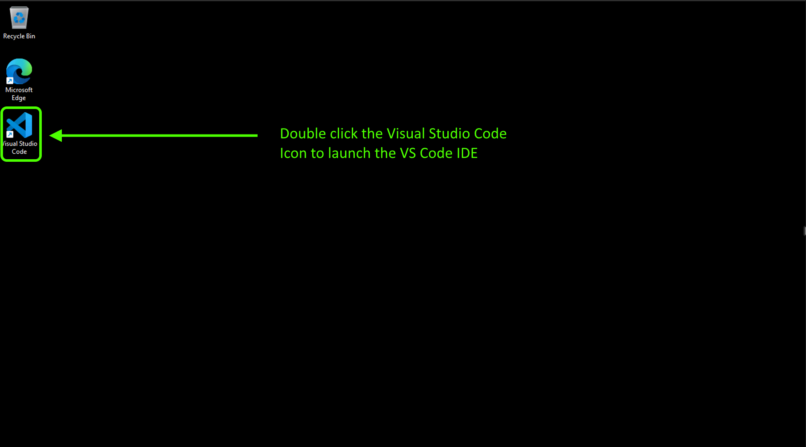
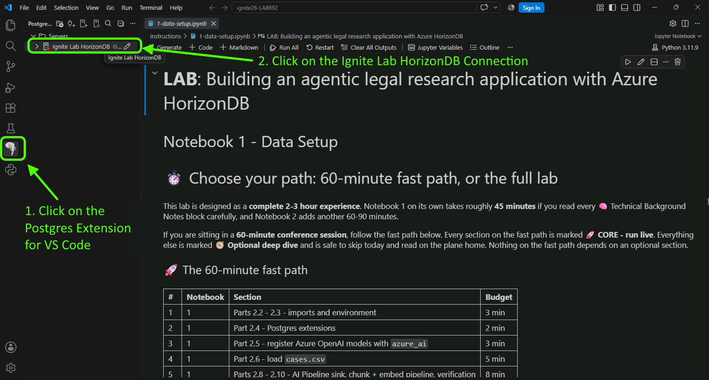
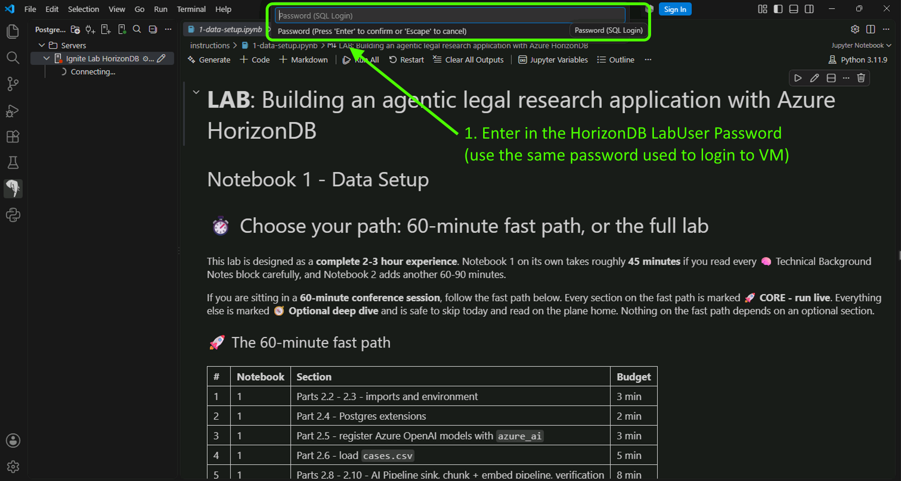
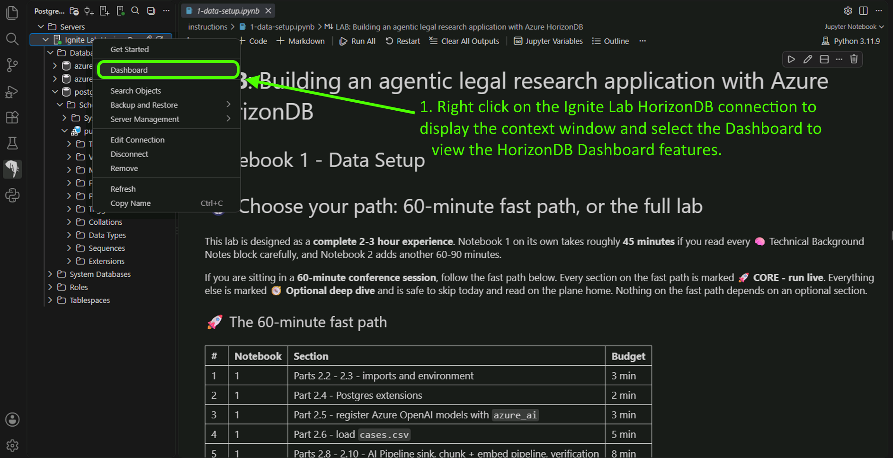
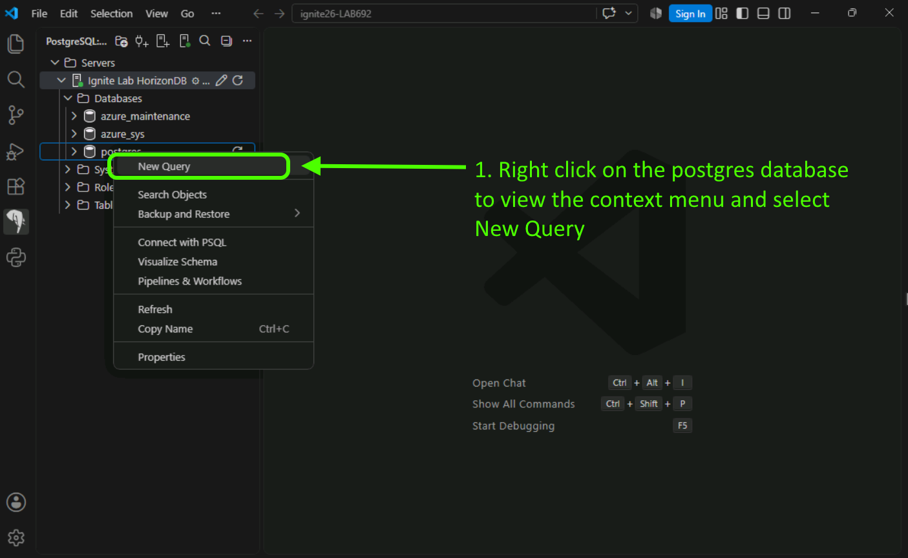
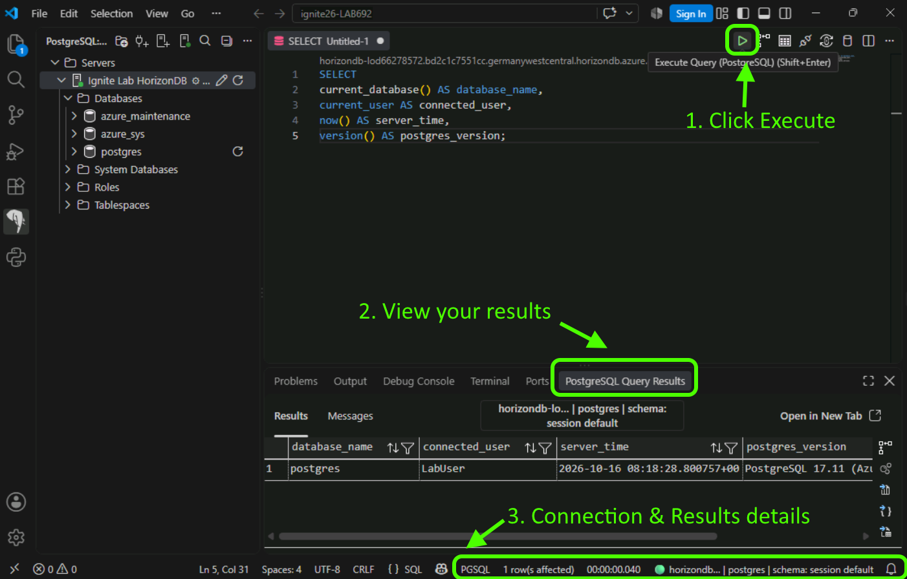

# Part 1: Connect to your Azure HorizonDB database

In this exercise, you will connect to HorizonDB using the PostgreSQL extension for VS Code, explore the database dashboard, and run a SQL query.

## Task 1: Open VS Code and set up a connection to HorizonDB

1. Go to your desktop and double-click the **VS Code** icon to open VS Code on your lab VM.

    

1. Select the **VS Code Extension for PostgreSQL** icon in the activity bar to open the extension.

    

## Task 2: Enter your HorizonDB password

1. Most connection details have been populated for you. Select the server connection and, when prompted, enter your lab VM **Password: `@lab.VirtualMachine(Win11-Pro-Base).Password`** to connect to your HorizonDB instance.

    

    > [!NOTE]
    > During lab creation, we added a firewall rule to allow connections from the lab environment to your HorizonDB instance. When setting up your own environment, configure firewall rules to allow only trusted IP addresses to reach your HorizonDB resource.

**Congratulations, you just signed in to your Azure HorizonDB database using the VS Code Extension for PostgreSQL!**

---

## Task 3: Explore the PostgreSQL extension dashboard

1. Now that you've created a connection, let's explore the VS Code Extension for PostgreSQL and your HorizonDB database. Right-click your **Ignite Lab HorizonDB** connection and select **Dashboard** from the context menu.

    

1. When the dashboard loads, review the performance details, including **wait events, disk I/O, transactions, and storage**.

1. Expand the **Databases** node under the **Ignite Lab HorizonDB** connection. Right-click the **postgres** database and select **New Query** from the context menu.

    

1. Copy and paste the following SQL into the query editor, then select the green play arrow at the top right to execute it. This query demonstrates how to run queries and view results using the VS Code Extension for PostgreSQL.

    During this lab, most SQL queries will be run programmatically using Python and the *psycopg* package. You'll also run a few queries using the extension's query editor.

    ```sql
    SELECT 
    current_database() AS database_name,
    current_user AS connected_user,
    now() AS server_time,
    version() AS postgres_version;
    ```

    

## Next Steps

> Select **Next >** to proceed to the next part of the lab.
